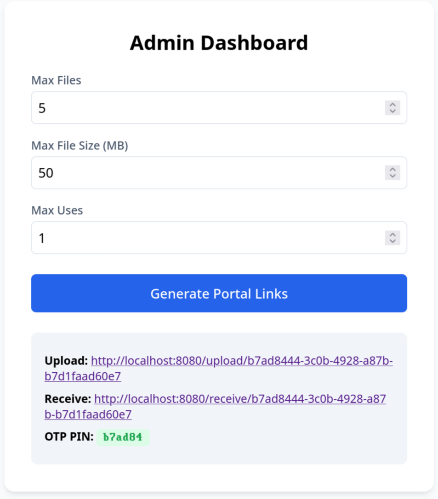
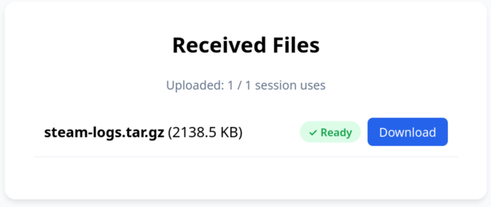
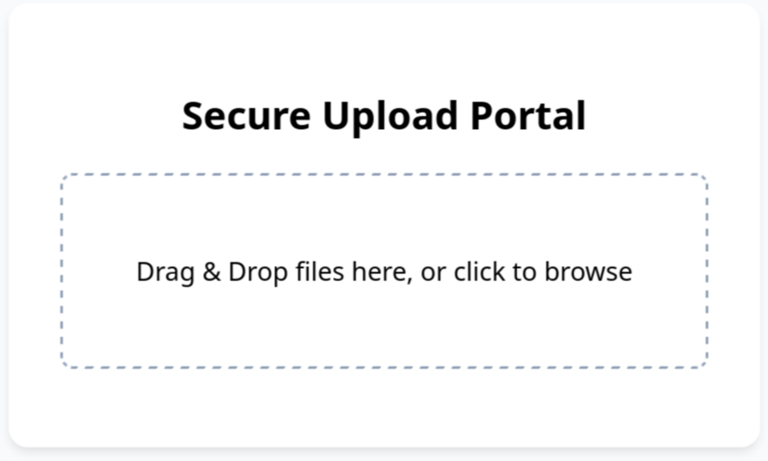
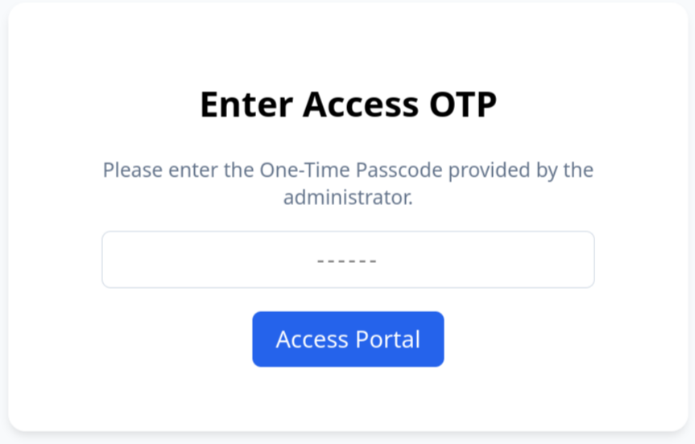

# uport

A file upload and receive portal featuring dual-portal URLs.







## How does it work

The server creates a portal with two urls, one for upload one for download. You
copy paste one of the url to the person you want to share and off you go. Url
is protected by an OTP.

## How to create a portal

Go to the `/admin` page and click `Create`. The admin page is not protected,
you might want to add authentication yourself.

## Usage

### Running Locally

```bash
# Start the server (listens on port 8080 by default)
uport-server
```

### NixOS Deployment

Add the flake input to your server configuration and enable the service:

```nix
{
  services.uport = {
    enable = true;
    port = 8080;
    storagePath = "/var/lib/uport";
  };
}
```
